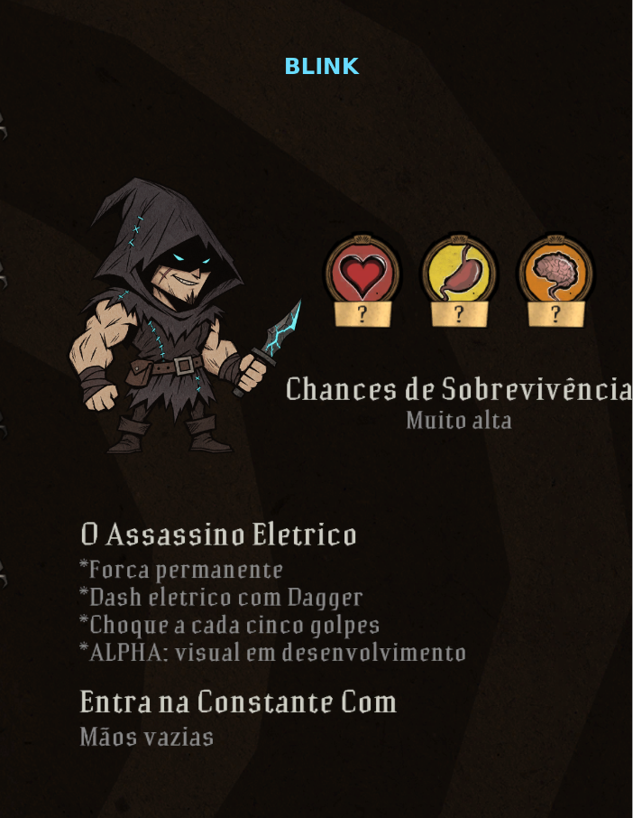
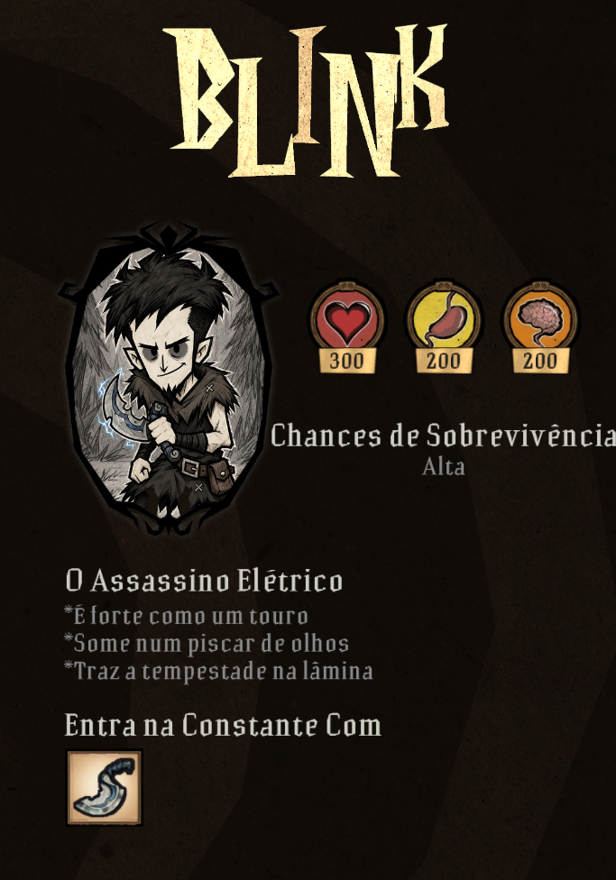

# DEVLOG — BLINK, um mod de personagem para Don't Starve Together

Este é o registro de como o BLINK saiu de uma ideia, passou por uma versão com visual emprestado e chegou à versão 1.0.0, publicada na Steam Workshop e jogada por outras pessoas. Foi tudo feito numa colaboração longa com uma IA (Claude). Eu, o desenvolvedor, defini o personagem, gerei a arte, testei no jogo e tomei as decisões; a IA escreveu o código, montou o pipeline de arte e propôs soluções.

O objetivo deste documento é mostrar o processo real, inclusive o que deu errado.

---

## Sumário
1. [Ponto de partida e evolução do escopo](#1-ponto-de-partida-e-evolução-do-escopo)
2. [Metodologia de colaboração com IA](#2-metodologia-de-colaboração-com-ia)
3. [Economia de tokens e de retrabalho](#3-economia-de-tokens-e-de-retrabalho)
4. [Linha do tempo da construção](#4-linha-do-tempo-da-construção)
5. [Erros reais e como foram resolvidos](#5-erros-reais-e-como-foram-resolvidos)
6. [Decisões de arquitetura](#6-decisões-de-arquitetura)
7. [Aprendizados transferíveis](#7-aprendizados-transferíveis)

---

## 1. Ponto de partida e evolução do escopo

| Antes (arte provisória) | Depois (v1.0) |
|:---:|:---:|
|  |  |

**Início.** **Origem.** Comecei tentando entender o mod *NPC Friends* e suas configurações. A partir disso, perguntei à IA se conseguiria criar meu próprio personagem: o BLINK, com a força do Wolfgang no estado forte e uma adaga elétrica inspirada na *Blink Dagger* do Dota 2. Também defini a identidade de assassino e escolhi deixar o capuz abaixado, para não atrapalhar o visual dos capacetes. Nenhum asset do NPC Friends ou do Dota foi usado.

**O ciclo de trabalho.** Eu descrevia o comportamento que queria, a IA implementava o código, e eu instalava e testava no jogo.

| Versão | O que aconteceu |
|---|---|
| **0.1** | Habilidades testadas com aparência provisória. Depois de uma dificuldade inicial para ativar o dash, confirmei que funcionava. |
| **0.2** | Ajustes pedidos depois do teste: direção do dash, recarga e transporte de objetos pesados (estado forte permanente). |
| **0.3** | Eu notei que a tecla tinha mudado de **G** para **5** por um erro de edição da IA. Pedi a correção e um **menu individual de controles** (F6), com a escolha salva localmente para cada jogador. |
| **0.4** | Receita da Dagger e controles ampliados para **botões extras e scroll do mouse**. |

Fui construindo o mod nesse ciclo: eu definia, testava, apontava os problemas e ajustava os pedidos, uma versão de cada vez. A partir da 0.4, o trabalho continuou com as regras abaixo.

A partir dali, defini regras de trabalho que valeram até o fim:
- entregar cada versão como `BLINK_vX.Y_alpha.zip`;
- explicar o que mudou, o que foi testado e como atualizar;
- **nunca afirmar que algo foi testado no jogo se não foi**;
- não publicar na Workshop sem pedido explícito;
- avisar com clareza se o ambiente de edição estiver indisponível.

**Como o escopo cresceu, por ordem:**
1. **Novo item:** a "Pedra do Ímpeto", que depois virou **Runa Elétrica**, um amuleto que deixa o dash sem recarga.
2. **Arte própria da Dagger:** na mão, no chão, boiando na água e no inventário.
3. **Mecânicas da Dagger:** desgaste, choque em cadeia a cada 5 golpes, luz no estilo da Estrela da Manhã.
4. **Visual próprio do personagem.** Foi a parte mais longa, com três abordagens: recolorir o Wolfgang por código, depois folhas de IA, depois uma nova direção de arte no estilo Don't Starve.
5. **Tela de seleção, fantasma, ícones e animação de comer.**
6. **Falas e idiomas:** falas sarcásticas próprias, em inglês e português.
7. **Equilíbrio:** a versão "divertida" era forte demais e foi rebalanceada em conjunto.
8. **Publicação** na Steam Workshop.

Uma mudança de direção importante: no começo a ideia era um **corpo musculoso** (Wolfgang forte com cabeça normal). Depois de ver a arte nova, decidi descartar o visual musculoso e manter só os atributos: *"o corpo magro está ok"*. A força continuou na mecânica, não no desenho.

---

## 2. Metodologia de colaboração com IA

### Como os pedidos eram estruturados
- **Pedido curto e direto, com print ou vídeo do jogo.** Quase toda iteração começava com uma captura e uma frase ("as mãos estão ao contrário e ele ficou muito pequeno"). A IA extraía quadros dos vídeos com `ffmpeg` e analisava antes de propor.
- **Separar análise de execução.** Em vários momentos pedi explicitamente: *"Apenas analise, não prossiga ainda"* e *"Não execute, analise comigo primeiro"*. O equilíbrio do personagem, por exemplo, foi negociado em quatro rodadas de proposta e contraproposta antes de qualquer código.
- **A IA perguntava quando a ambiguidade mudava o resultado.** Exemplo: "máquina de magia nível 2" podia ser mais de uma estação; a IA perguntou e eu escolhi o Manipulador das Sombras. Na Runa, "ilimitado" podia significar sem recarga ou sem gasto de usos; a IA expôs as duas leituras e eu escolhi a primeira.
- **Pedir senso crítico, não concordância.** Em várias situações a resposta foi "não recomendo": o custo de 15 rochas lunares, 15 ouros e 5 gemas roxas para a Runa, vida 100 combinada com outras desvantagens, a opção de dash infinito sem gasto de usos. Cada recusa veio com números de comparação tirados do código do jogo.

### Fluxo de trabalho que se estabeleceu
1. Peço a mudança, com print ou vídeo.
2. A IA reproduz o problema num **renderizador próprio**, que monta o personagem com as animações reais do jogo.
3. A IA corrige, recompila, roda os testes e gera uma **prévia a partir do arquivo compilado**, e não das peças soltas.
4. A IA aplica os arquivos alterados **direto na pasta do mod no meu PC** e envia um ZIP de backup.
5. Eu fecho e abro o DST, testo e mando o próximo print.

O passo 4 nasceu de um pedido meu: *"Você não pode ficar com acesso ao meu computador e ir alterando pra mim, ao invés de toda alteração você mandar o arquivo e eu ter que baixar e alterar?"*. Antes disso, a IA tinha gravado na minha pasta uma vez sem perguntar. Ela reconheceu o erro, passou a pedir permissão, e depois combinamos que aplicar direto virava o padrão.

### Geração de arte com IA (Leonardo.ai, GPT Image 2.5)
- A IA escrevia **prompts completos por folha** (cabeças base, expressões de frente em duas partes, expressões de perfil, peças do corpo). Cada prompt trazia um bloco de estilo fixo e a lista exata do que desenhar.
- **O que funcionou:**
  - uma única **folha mestre** como referência de personagem;
  - Style **None**;
  - formato 16:9;
  - fundo branco;
  - a frase "Do NOT copy the layout of the reference image".
- **O que precisou ser corrigido:**
  - Na primeira tentativa colei só o bloco de estilo, e o gerador copiou a referência. Resolvido com o prompt completo.
  - Com cinco personagens do jogo como referência ao mesmo tempo, o resultado "saiu da ideia de Don't Starve". Resolvido usando só a folha mestre, com força alta, mais **uma** referência de estilo, com força baixa.
  - A IA sugeriu **fundo cinza** para recortar pele clara. Foi um erro dela: deixou tudo opaco. Voltamos ao branco, porque o contorno preto já basta para o recorte.

---

## 3. Economia de tokens e de retrabalho

Exemplos reais de ajustes que evitaram trabalho ou contexto desnecessário:

- **Inspecionar o jogo antes de gerar arte.** Para o fantasma, a IA já tinha escrito um prompt de folha nova. Eu disse: *"Acho melhor você já olhar o arquivo do jogo antes de pedir, pois meus tokens estão acabando"*. Ao abrir o `ghost_wilson_build`, ela viu que só duas peças mudam por personagem (`ghost_Hat` e `ghost_eyes`). A folha inteira foi descartada e o fantasma saiu da arte que já existia.
- **Reaproveitar o próprio jogo em vez de gerar:**
  - **Nome dourado:** montado com letras originais dos nomes da Klei (B do WEBBER, L, I e N do WILSON, K do WICKERBOTTOM), em vez de pedir uma "fonte parecida" a um gerador que erra letras.
  - **Moldura oval:** recortada de dois retratos oficiais e espelhada.
  - **Mãos:** as 20 poses de mão do jogo repintadas com a pele do BLINK, em vez de uma folha nova de mãos.
  - **Bochechas de comer:** as do Wilson repintadas.
- **Gerar menos imagens por rodada.** Quatro gerações nas folhas críticas (cabeças, peças) e duas nas de expressão.
- **Renomear só o necessário.** Pedi para renomear os arquivos; a IA disse que identificava pelo conteúdo e só as duas folhas parecidas (`folha2` e `folha3`) precisavam de nome.
- **Conferência em lote.** As 33 expressões foram verificadas numa única imagem de conferência, em vez de uma por uma. Foi assim que apareceu o bug do olho apagado.
- **Aplicar direto no PC.** Acabou o ciclo baixar ZIP, extrair e substituir a cada versão.
- **Contexto compactado.** A conversa ficou longa demais e foi retomada a partir de um resumo estruturado, com estado atual, arquivos, erros já resolvidos e próximo passo. O trabalho continuou do ponto exato, sem refazer nada.
- **"Pare, pense e refaça até ficar satisfeito."** Depois de duas correções incompletas (botas e depois mãos), pedi uma rodada mais cuidadosa. A IA passou a comparar pose a pose com o Wilson, na mesma escala, antes de entregar.

---

## 4. Linha do tempo da construção

| Fase | Versões | O que aconteceu |
|---|---|---|
| **Primeiras versões** | 0.1 – 0.4 | Mecânicas com visual provisório: dash, choque, força permanente, menu de tecla (F6), receita da Dagger, mouse. |
| **Item novo** | 0.5 – 0.6.x | Pedra do Ímpeto (amuleto de corpo, dash sem recarga). Renomeada para **Runa Elétrica**, com receita no Manipulador das Sombras e +10% de velocidade. Arte em três variantes (A, B, C); escolhi a B (pedra escura com moldura e engastes dourados). |
| **Dagger** | 0.6.1 – 0.6.11 | Arte na mão, chão e inventário. Lâmina virada para baixo (0.6.4) e menor (0.6.5). Choque em cadeia, luz ciano, desgaste, dash gastando usos. Som ao equipar adicionado e depois removido a pedido (0.6.11). |
| **Dagger na água** | 0.6.8 – 0.6.10 | Item sumia ao boiar. Duas hipóteses erradas antes da certa (ver erros). |
| **Corpo, 1ª abordagem** | 0.7.0 – 0.7.2 | Cabeça do Wilson e corpo do Wolfgang recoloridos por código. Corpo invisível na 0.7.0, corrigido na 0.7.1. Rejeitado: *"Sinceramente, tá muito ruim"*. |
| **Corpo, 2ª abordagem** | 0.8.0 | Sete folhas geradas por IA, recortadas e encaixadas automaticamente. Funcionou, mas o olho esquerdo sumia em cerca de 20 das 33 expressões. |
| **Nova direção de arte** | — | Folha mestre no estilo Don't Starve: pele marfim, olhos pretos com olheira (sem o azul, *"muito distante da arte do Don't Starve"*), topete mais baixo para caber capacete. Cinco folhas novas. |
| **Corpo, 3ª abordagem** | 0.9.0 – 0.9.5 | Corpo inteiro com a arte nova. Botas invertidas (0.9.1), mãos invertidas e cabeça pequena (0.9.2), recorte do cabelo e cabeça descentralizada (0.9.3), fantasma não aplicado (0.9.4), cabelo do fantasma refeito (0.9.5). |
| **Tela de seleção** | 0.10.0 – 0.10.3 | Nome dourado, retrato oval (arte final gerada com a Dagger como referência), atributos, item inicial, textos implícitos como os oficiais, ícones, bochechas ao comer. |
| **Falas e idiomas** | 0.11.0 | Cerca de 90 falas sarcásticas em inglês e em português, `lang.lua`, opção de idioma, ícone do mod, retirada do "ALPHA". |
| **Arte nova da Runa** | 0.12.0 | Pedra-raio com gemas, corda e corrente. Dagger 12% menor na mão. |
| **Equilíbrio** | 0.13.0 – 0.13.1 | Rebalanceamento completo (ver abaixo). Valores fixos, com o menu do mod reduzido ao idioma. |
| **Publicação** | 1.0.0 | Nome "BLINK", autor "Projeto BLINK", capa e descrição bilíngue. Publicado como *Friends Only*, testado em multiplayer com outros jogadores e então aberto ao público. |

### O equilíbrio, em números
A primeira versão divertida tinha:
- vida 300;
- força 2x permanente;
- Dagger de 70 de dano real, praticamente uma Espada Sombria;
- receita de 2 salitre e 1 sílex, sem estação;
- nenhum ponto fraco.

Depois de quatro rodadas de discussão:

| | Antes | Depois |
|---|---|---|
| Vida / Sanidade | 300 / 200 | 125 / 250 |
| Força | 2x fixa | 1,25x / 1,5x / 2x conforme a fome (2x gasta fome 25% mais rápido) |
| Dagger | 35 de base, sem estação | 38 de base, Motor de Alquimia, receita com ouro |
| Dash | 100 de dano, 5 s | 50 de dano, 8 s |
| Runa | 50 usos, só com a Dagger | 30 usos; dá o dash sozinha; com a Dagger, sem recarga |
| Ponto fraco | — | Molhado: faíscas e dano leve; encharcado: sem dash e sem choque |

---

## 5. Erros reais e como foram resolvidos

| Problema (versão em que apareceu) | Hipóteses / causa real | Solução |
|---|---|---|
| **Dagger compilada, mas mão vazia** (0.6.1) | A primeira hipótese (fallback entre servidor e cliente) estava errada. A causa real: o build não cobria os quadros que as animações do jogador pedem. | Espelhar a cobertura de quadros da lança original (`swap_object` 0–2, 5, 6, 7, 8). |
| **Contorno branco nos ícones** | As texturas não usavam alfa pré-multiplicado, como o jogo espera. | Todas as texturas regeradas com alfa pré-multiplicado; virou teste automatizado. |
| **Dagger invisível na água** (0.6.8 – 0.6.10) | 0.6.8: dados de troca errados. 0.6.9: "faltam quadros", hipótese errada. 0.6.10: mover a peça para um build separado resolveu, mas por acaso. | A causa real só apareceu na 0.7.1 (linha abaixo). |
| **Corpo inteiro invisível** (0.7.0) | **Os símbolos do build precisam estar em ordem crescente de hash.** Fora de ordem, o jogo não os encontra. Era a mesma causa da Dagger na água. | Ordenação no compilador e um teste que verifica a ordem em **todos** os builds. |
| **Olho esquerdo apagado em cerca de 20 expressões** (0.8.0) | A máscara que separava cabelo de rosto **por cor escura** apagou o contorno do olho, também escuro. | Na arte nova, o recorte passou a ser feito pelo **interior da pele do rosto**, mais a conferência visual das 33 peças antes de compilar. |
| **Olhos brancos às vezes** | Um quadro de rosto (14) vinha do molde original, com manchas brancas. | Quadro substituído por peça vazia. |
| **Botas viradas para trás** (0.9.0) | A regra de espelhamento estava invertida em relação ao desenho da folha. | Regra corrigida e comparação pose a pose com o Wilson. |
| **Mãos ao contrário** (0.9.1) | Uma mão genérica girada para encaixar em 20 poses diferentes. | Usar a pose de mão do próprio jogo para cada quadro, só repintada. |
| **Personagem pequeno demais** | Cabeça calibrada pela largura da pele, menor que a referência do jogo. | Medição lado a lado com o Wilson na mesma escala; cabeça 1,7x maior. |
| **Pontos brancos no cabelo e cabeça "torta"** (0.9.2) | O fundo branco preso entre as pontas do cabelo entrava como parte da cabeça, e a mesma área deslocava o centro calculado. | Remover bolsões de fundo encostados na borda; borda externa convertida em nanquim com transparência; centro pelo meio dos olhos. |
| **Fantasma não mudava** (0.9.3) | O jogo usa o `ghost_skin` da **skin** (`blink_none`) antes do `inst.ghostbuild` do personagem, e a skin ainda apontava para o Wilson. | Corrigir a skin e adicionar um teste. |
| **Cabelo do fantasma "parecendo risco do Paint"** (0.9.4) | Só a faixa do cabelo, com contorno fino e franja cheia de pontinhas. | Silhueta cheia do alto da cabeça simplificada num polígono (`cv2.approxPolyDP`), contorno grosso só no topo e base sem contorno. |
| **Animação de comer sem bochechas** (0.10.2) | Na reconstrução do corpo, o símbolo `cheeks` ficou vazio por engano. | Bochechas do Wilson repintadas e conferidas com a animação real de comer. |
| **Teste quebrado por substituição global** | Ao trocar "49" por "29" em massa no arquivo de testes, um teste sem relação foi alterado junto. | Detectado na execução e revertido na linha específica. |
| **Opções do mod em inglês com o jogo em português** | O `modinfo` só recebe o código de idioma **oficial** do jogo, e o meu jogo está em português por um **mod de tradução**. Para o DST, ele está em inglês. | Dentro do jogo, a opção "Language" escolhe o português. A tela de opções do mod segue a língua oficial do jogo, uma limitação do próprio DST. |

---

## 6. Decisões de arquitetura

### Compilador de animação próprio (`art/klei_anim.py`)
Eu não conhecia o *Don't Starve Mod Tools*, e depender dele travaria cada iteração de arte. A IA implementou um compilador mínimo do formato do jogo, conferido byte a byte contra arquivos reais:
- **BILD v6:** símbolos, quadros, vértices e tabela de nomes, com hash *sdbm* em minúsculas.
- **Atlas KTEX:** DXT5 com cadeia completa de mipmaps, guardado de baixo para cima, com alfa pré-multiplicado.
- **Texturas de interface:** RGBA sem compressão.

Assim, qualquer mudança de arte vira um comando Python, sem abrir o Spriter.

### Renderizador de prévia (`compor.py`)
Lê os arquivos de animação reais do jogo (`player_idles`, `player_basic`, `player_attacks`, `player_actions_eat`, `player_ghost_withhat`…) e monta o personagem com as transformações de cada quadro.

Ele permitiu reproduzir no sandbox os bugs que eu via no jogo e comparar o BLINK com o Wilson **na mesma pose e escala**. A regra era sempre gerar a prévia **a partir do ZIP compilado**, e não das peças soltas.

### Encaixar arte nova em animações nativas
O BLINK não tem animações próprias: usa as do jogador e substitui as peças (`headbase`, `face` 0–32, `torso`, `hand` 0–19, `leg`, `foot`, `cheeks`…), usando os quadros do Wilson e do Wolfgang como molde de tamanho e pivô. Com isso:
- todas as ações do jogo (comer, colher, montar, nadar) funcionam de graça;
- o trabalho de arte se resume a um conjunto finito de peças.

### Mecânicas num componente único (`components/blinkpower.lua`)
- Dash validado **no servidor**: posição do servidor, direção enviada pelo cliente via RPC, proteção contra spam de 0,15 s, colisão com paredes, penhascos e oceano.
- Dano direto via `GetAttacked`, que **ignora o multiplicador de força** (escolha consciente: dash e choque têm dano fixo) mas respeita armadura.
- Choque em cadeia usando o evento nativo `electrocute` com `numforks=0`: o jogo cuida do visual e do atordoamento, e os saltos com dano ficam no código do mod, com proteção para aliados, jogadores e seguidores.
- Força pela fome via `combat.damagemultiplier` e `hunger.burnratemodifiers`.
- Fraqueza à água no mesmo modelo do WX-78, reaproveitando o efeito `sparks` e o evento `wx78_spark`.
- O estado vai para o cliente por *netvars* (recarga, golpes, usos da Runa, faixa de força, molhado), que alimentam a linha do HUD.

### "Força" sem quebrar o visual
A primeira versão usava o componente nativo `mightiness` do Wolfgang, travado em "forte" (`permanent_mighty.lua`). Assim as animações de andar e trabalhar do Wolfgang forte funcionavam sem o personagem se transformar no Wolfgang. A força de dano em si ficou no multiplicador de combate do BLINK, porque a regra combinada era que o multiplicador é **do personagem, não da arma**.

### Textos e idiomas (`scripts/blink/lang.lua`)
- Todos os textos de interface ficam numa tabela por idioma (`en`, `pt`).
- As falas ficam em `speech_blink_en.lua` e `speech_blink_pt.lua`.
- O que não tem fala própria cai nas falas genéricas do jogo, já traduzidas. Por isso nada aparece como "UNKNOWN STRING".
- Um teste garante que os dois idiomas têm exatamente as mesmas chaves.

### Testes sem o jogo (`tests/`)
- `run_tests.py` carrega a `liblua5.4` via `ctypes`, compila todos os scripts e valida a estrutura binária dos assets: ordem de hash, cobertura de quadros e alfa pré-multiplicado.
- `behavior.lua` simula o motor (entidades, inventário, mapa, tempo) e testa as regras de jogo.
- O relatório termina sempre com o que **não** foi testado.

---

## 7. Aprendizados transferíveis

1. **Teste cedo e no ambiente real.** O erro da tecla G virando 5 (0.2) só apareceu porque cada versão era jogada logo depois de entregue. Mudanças pequenas e testadas uma a uma tornam o erro fácil de localizar.
2. **Quando um bug "some por acaso", ainda não está resolvido.** A Dagger na água voltou a funcionar na 0.6.10 sem que soubéssemos o porquê. A causa real (ordem de hash) derrubou o corpo inteiro duas versões depois. Desde então, toda causa raiz encontrada virou um teste.
3. **Construa ferramentas de observação antes de corrigir às cegas.** O renderizador de prévia e as folhas de conferência em lote encontraram mais bugs que qualquer leitura de código.
4. **Compare com uma referência na mesma escala.** "Pequeno demais", "mãos ao contrário" e "torto" só ficaram objetivos quando o personagem foi posto ao lado do Wilson, na mesma pose.
5. **Reaproveite antes de gerar.** Letras, moldura, poses de mão, bochechas e o fantasma vieram do próprio jogo: mais consistentes, mais rápidos e mais baratos que gerar com IA.
6. **Separe "analisar" de "executar".** As discussões de equilíbrio e de direção de arte economizaram várias versões descartáveis.
7. **Peça discordância.** Os melhores ajustes vieram de respostas "não recomendo, por causa disto", com números do código do jogo, e não de concordância automática.
8. **Seja explícito sobre o que foi testado.** "Testado com motor simulado" e "testado no jogo" são coisas diferentes, e o relatório precisa dizer qual das duas aconteceu.
9. **Na geração de imagem, menos referências dá mais controle.** Uma folha mestre forte mais uma referência de estilo fraca funcionou muito melhor que cinco referências misturadas.

---

*Status na data deste registro: v1.0.0 publicada na Steam Workshop. Primeiro como "Friends Only", testada em multiplayer com outros jogadores e depois aberta ao público.*
