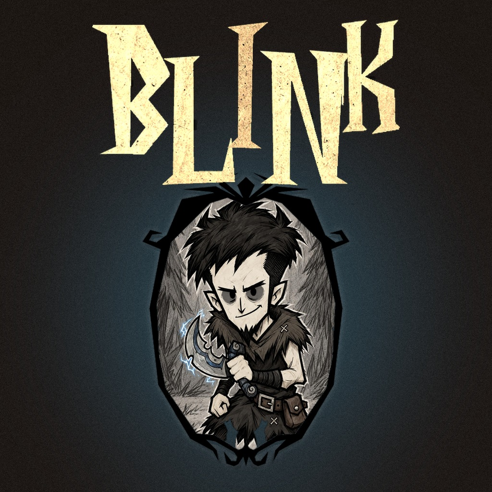
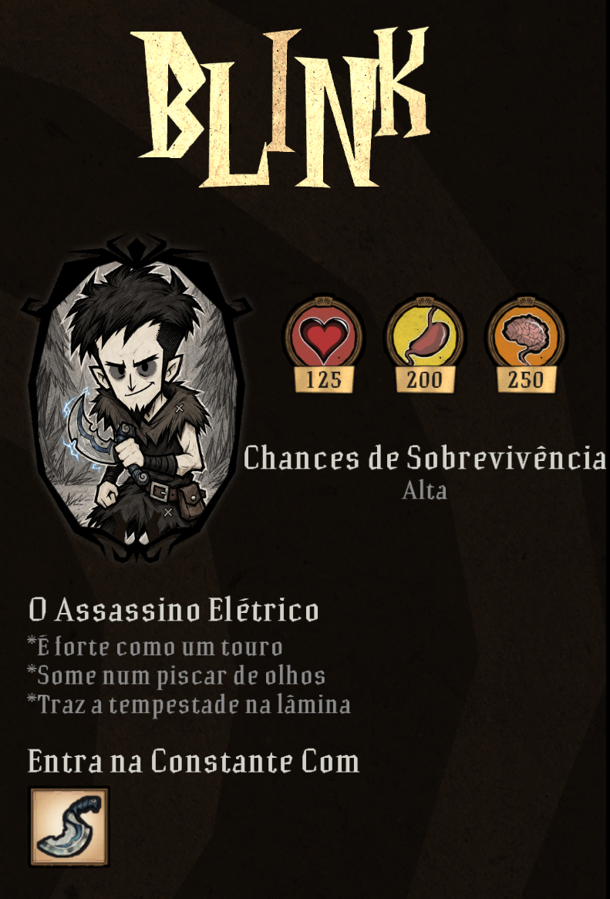
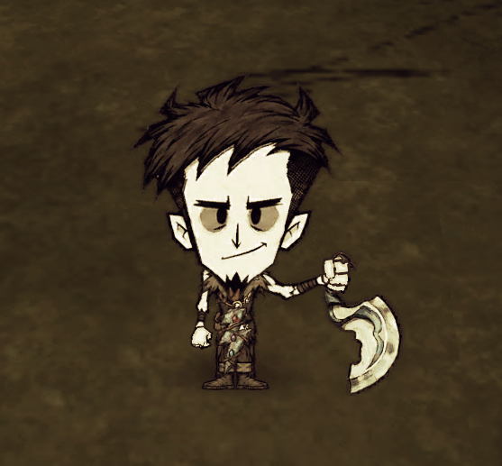
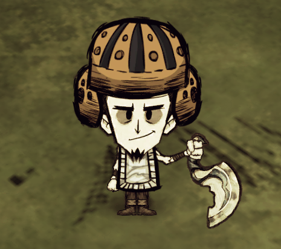
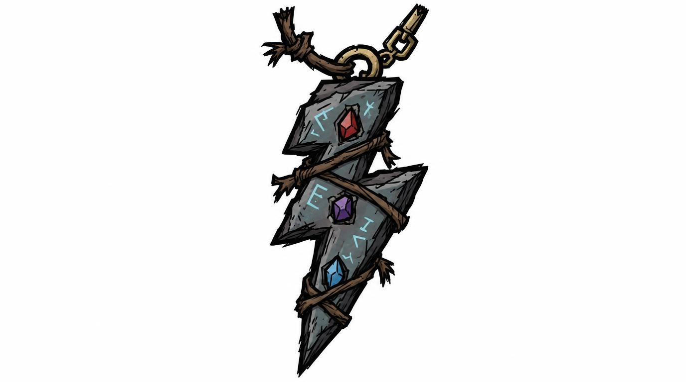

# BLINK — The Electric Assassin

> Personagem para **Don't Starve Together**: um assassino sarcástico que ataca como um raio, some num piscar de olhos e entra em curto-circuito na chuva.


<p align="center"></p>

🎮 **Jogue:** [BLINK na Steam Workshop](https://steamcommunity.com/sharedfiles/filedetails/?id=3834518011)

📖 **Como foi feito:** leia o [**DEVLOG.md**](DEVLOG.md), com a jornada completa de desenvolvimento, os erros reais e as decisões de projeto.

---

## O que o mod faz

BLINK é um personagem de combate frágil e rápido. Ele bate forte quando está bem alimentado, limpa grupos de inimigos com choques em cadeia e depende de ficar seco.

| Tela de seleção | No mundo | Com capacete |
|:---:|:---:|:---:|
|  |  |  |

### Atributos

| Vida | Fome | Sanidade | Item inicial |
|:---:|:---:|:---:|:---:|
| 125 | 200 | 250 | Dagger |

### Habilidades

- **Força movida pela fome.** O multiplicador de dano vale para todas as armas:
  - acima de 75% de fome: **2x**, e a fome cai 25% mais rápido;
  - entre 30% e 75%: **1,5x**;
  - abaixo de 30%: **1,25x**.
- **Dagger.** Lâmina curva elétrica com 38 de dano e 150 usos, que ilumina ao redor quando equipada.
- **Dash elétrico.** A tecla **G** faz ele avançar até 8 unidades, causando 50 de dano a quem estiver no caminho. Recarga de 8 s. A tecla **F6** abre um menu pessoal para trocar a tecla, aceitando também botões extras e o scroll do mouse.
- **Choque em cadeia.** A cada 5 golpes de Dagger, um choque de 50 de dano atordoa o alvo e salta para até 5 inimigos próximos. Cada criatura é atingida uma vez.
- **Runa Elétrica.** Amuleto de corpo:
  - sozinha, dá o dash com a recarga normal;
  - **junto com a Dagger, o dash fica sem recarga**;
  - +10% de velocidade de movimento e 30 usos.

<p align="center"></p>

### Ponto fraco

- **Eletricidade e água não combinam.** Acima de 15% de umidade, ele solta faíscas e toma dano leve (o mesmo efeito do WX-78). A partir de 50%, perde o dash e o choque em cadeia.

### Receitas

| Item | Ingredientes | Estação |
|---|---|---|
| Dagger | 2 Sílex, 1 Salitre, 1 Pepita de Ouro | Motor de Alquimia |
| Runa Elétrica | 1 Gema Roxa, 3 Rochas Lunares, 4 Pepitas de Ouro, 2 Combustíveis de Pesadelo | Manipulador das Sombras |

### Conteúdo próprio

- Corpo, cabeça, 33 expressões faciais, roupas, mãos e botas, encaixados nas animações nativas do jogador.
- Fantasma, retrato da tela de seleção, nome dourado, ícones de mapa, avatar e ícone do mod.
- Cerca de 90 falas sarcásticas em cada idioma.
- **Inglês e português (BR)**: segue o idioma do jogo ou pode ser escolhido nas configurações do mod.

---

## Instalação

### Pela Steam Workshop (recomendado)
1. Abra a [página do mod](https://steamcommunity.com/sharedfiles/filedetails/?id=3834518011) e clique em **Inscrever-se**.
2. Abra o DST e, em **Mods**, ative o **BLINK**.
3. Crie ou entre num mundo e escolha o BLINK na tela de seleção.

### Manual (a partir deste repositório)
1. Copie a pasta `blink/` para `...\Steam\steamapps\common\Don't Starve Together\mods\`.
2. Ative o mod no menu **Mods** do jogo.

> Todos os jogadores do servidor precisam ter o mod. Pela Workshop, ele é baixado automaticamente.

---

## Estrutura do projeto

```
.
├── blink/                    # O mod (o que vai para a Workshop)
│   ├── modinfo.lua           # Nome, versão e opção de idioma
│   ├── modmain.lua           # Valores de equilíbrio, textos, receitas, RPC do dash, HUD
│   ├── anim/                 # Builds compilados: corpo, Dagger, Dagger boiando, Runa, fantasma
│   ├── bigportraits/         # Retrato oval da tela de seleção
│   ├── images/               # Nomes dourados, avatares, mapa, inventário, save slot
│   └── scripts/
│       ├── prefabs/          # blink, blink_none (skin), blink_dagger, blink_impeto (Runa)
│       ├── components/       # blinkpower.lua: dash, choque, força pela fome, fraqueza à água
│       ├── blink/            # targets, math, keybind, keymenu (F6), lang (EN/PT), permanent_mighty
│       └── speech_blink_en.lua / speech_blink_pt.lua
├── art/                      # Pipeline de arte em Python (gera e compila os assets)
│   ├── klei_anim.py          # Compilador próprio de builds do DST, sem Mod Tools
│   ├── klei_read.py          # Extrator de builds do jogo para peças PNG
│   ├── corpo/, corpo_v2/     # Montagem do corpo a partir das folhas de IA, fantasma, prévias
│   ├── selecao/              # Retrato oval e nome dourado
│   ├── referencias/          # Artes de referência
│   └── legado/               # Scripts das primeiras iterações (registro histórico)
├── tests/                    # Testes sem o jogo (liblua + motor simulado)
├── docs/
│   ├── pipeline-de-arte.md   # Como regerar cada asset
│   └── formato-klei.md       # O que aprendemos sobre o formato de animação do DST
├── imagens/                  # Imagens deste README e do DEVLOG
├── CHANGELOG.md              # Histórico versão a versão, de 0.1 a 1.0.0
├── DEVLOG.md                 # Como o projeto foi feito
├── VALIDACAO.txt             # Saída da última execução dos testes
└── FONTES.md                 # Referências técnicas consultadas
```

---

## Rodando localmente

### Testes
Os testes rodam sem o jogo: usam a `liblua5.4` via `ctypes` para carregar os scripts do mod e simular o motor do DST.

```bash
python3 tests/run_tests.py
```

Cada bloco verificado aparece como `PASS: ...`, e a saída termina deixando explícito o que **não** é coberto:

```
NOT RUN: DST startup, rendering, Mod Tools autocompiler, real combat, multiplayer and caves.
```

Entre outras coisas, os testes verificam:
- dash, recarga e choque;
- regras da Runa;
- força pela fome e fraqueza à água;
- receitas;
- símbolos dos builds em ordem de hash e cobertura de quadros;
- texturas com alfa pré-multiplicado;
- paridade de textos entre inglês e português.

### Arte
Requer Python 3 com Pillow, numpy e scipy (o fantasma usa também OpenCV). O passo a passo, incluindo quais arquivos do jogo são necessários, está em [`docs/pipeline-de-arte.md`](docs/pipeline-de-arte.md).

### Contribuindo
1. Abra uma issue com o problema (de preferência com print ou vídeo) ou a sugestão.
2. Rode `python3 tests/run_tests.py` antes de propor mudanças.
3. Não inclua assets de outros mods ou jogos.

---

## Sobre o desenvolvimento

- **Construído em colaboração com IA (Claude)**, em iterações curtas: eu definia o comportamento, a IA implementava, eu testava no jogo e apontava os problemas com prints e vídeos. Foram cerca de 40 versões, de 0.1 a 1.0.0.
- **Arte gerada por IA (Leonardo.ai)** a partir de folhas de personagem com prompts estruturados, depois recortada e encaixada automaticamente nas animações nativas do jogo pelo pipeline em Python.
- **Eficiência de contexto:** analisar antes de executar, inspecionar os arquivos do jogo antes de gerar arte nova e reaproveitar elementos do próprio jogo (letras, moldura, poses de mão) em vez de gerar do zero.
- **Validação honesta:** testes automatizados com o motor simulado, uma regra explícita de nunca declarar algo "testado no jogo" sem ter sido, e teste em multiplayer com outros jogadores antes de abrir ao público.

➡️ Detalhes, erros reais e aprendizados no [**DEVLOG.md**](DEVLOG.md).

---

## Créditos

- **Autor:** David Alexander ([@DavidChange](https://github.com/DavidChange)), publicado na Steam como "Projeto BLINK"
- **Ideia inicial:** inspirada na força do Wolfgang e na *Blink Dagger* do Dota 2. Nenhum asset de outro jogo ou mod foi usado.
- **Arte do personagem, da Dagger, da Runa e do retrato:** gerada pelo autor com Leonardo.ai (GPT Image 2.5).
- **Don't Starve Together**, suas animações e os elementos visuais reaproveitados (letras dos nomes, moldura dos retratos, poses de mão e bochechas, fantasma base): © Klei Entertainment. Este é um mod de fã, sem vínculo com a Klei.
- **Desenvolvimento assistido por:** Claude (Anthropic).

## Licença

© © 2026 David Alexander. Todos os direitos reservados.
